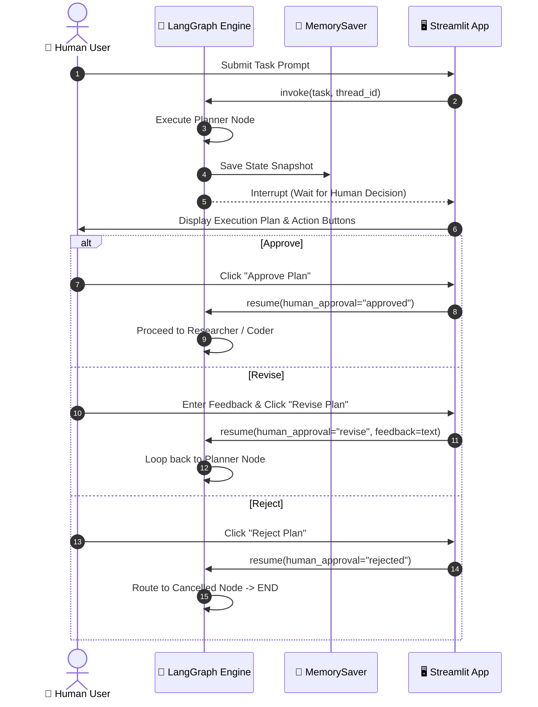
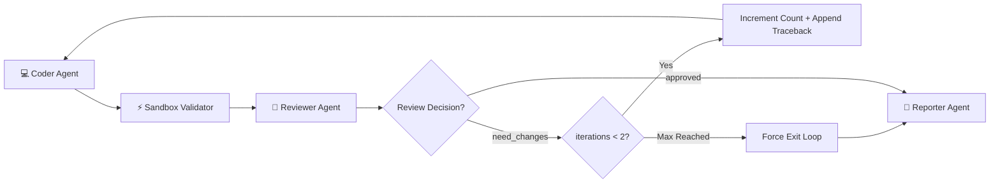
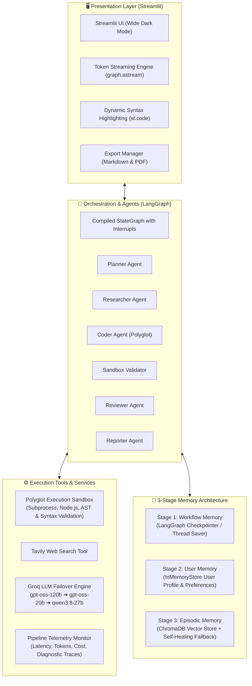

# ⚡ AgentMind: Polyglot Multi-Agent AI System

A modern, production-grade multi-agent AI system built on **LangGraph** and **Streamlit**. AgentMind takes natural language tasks, creates structured execution plans, enforces human-in-the-loop approvals, and orchestrates specialized agents for research, coding, execution validation, code review, and final reporting.

The system features **polyglot code generation** (Java Spring Boot, Go, TypeScript, Rust, Python, etc.), **multi-language sandbox validation**, **3-tier LLM failover resilience**, and a **3-stage memory architecture**.

---

### 🌐 Live Demo
👉 **[Launch AgentMind Live App](https://multi-agent-ai-system-abqntnv6lwbe7o4rjebluw.streamlit.app/)**

---

## 🌟 Key Features

- **🔄 LangGraph Cyclic Workflow:** Production StateGraph with human-in-the-loop interruption, dynamic research branching, sandbox validation, and a 3-way reviewer feedback loop with max revision guards.
- **🌍 Polyglot Multi-Language Support:** Automatically adheres to the language and framework defined in the approved plan (e.g. Java Spring Boot, Go, TypeScript/Node.js, Rust, C++, Python/FastAPI). The Researcher, Coder, Reviewer, and Reporter all align with the chosen technology stack.
- **⚡ Isolated Multi-Language Sandbox:**
  - **Python:** Executed securely in an isolated subprocess with timeout and safety checks.
  - **Node.js / JavaScript:** Executed via the `node` runtime.
  - **Compiled / Enterprise Stacks (Java, Go, Rust, C++):** Syntactically and structurally verified (class definitions, annotations, balanced braces, package imports) without crashing in the Python interpreter.
- **🛡️ 3-Tier Multi-Model LLM Failover:** Built with LangChain `.with_fallbacks()` on Groq API. Automatically cascades across models if daily token or rate limits are reached (`openai/gpt-oss-120b` $\rightarrow$ `openai/gpt-oss-20b` $\rightarrow$ `qwen/qwen3.8-27b`).
- **🧠 3-Stage Memory Architecture:**
  - **Stage 1 (Workflow Checkpointing):** LangGraph `MemorySaver` checkpointer preserving execution threads, state history, approval decisions, and revision counters.
  - **Stage 2 (User Memory):** LangGraph `InMemoryStore` persisting user profiles, formatting preferences, and coding styles across conversations.
  - **Stage 3 (Episodic Memory):** ChromaDB vector store for semantic recall of past runs with cross-version SQLite self-healing fallback.
- **📡 Real-Time Token Streaming:** Progressive token-by-token streaming via `graph.astream(..., stream_mode="messages")`.
- **📊 Telemetry & Observability:** Real-time tracking of token usage, latency per node, estimated API cost, failure diagnostics, and structured logs written to `logs/pipeline.log`.
- **📄 Export Formats:** Download complete deliverables as formatted Markdown or publication-ready PDFs.

---

## 🔄 Multi-Agent Workflow (LangGraph)

AgentMind is orchestrated as a cyclic, stateful **LangGraph StateGraph** that enforces human control, dynamic branching, automated self-correction, and iteration limits.

### 📊 Master Workflow Diagram

```mermaid
flowchart TD
    classDef startEnd fill:#1e293b,stroke:#3b82f6,stroke-width:2px,color:#fff;
    classDef agent fill:#0f172a,stroke:#6366f1,stroke-width:2px,color:#fff;
    classDef decision fill:#1e1b4b,stroke:#a855f7,stroke-width:2px,color:#fff;
    classDef loop fill:#2e1065,stroke:#ec4899,stroke-width:2px,color:#fff;
    classDef cancel fill:#3f1d1d,stroke:#ef4444,stroke-width:2px,color:#fff;

    Start([🚀 1. START: User Task]):::startEnd --> Planner[📋 2. Planner Agent<br/>Breaks down goals, defines roles & assesses research]:::agent
    
    Planner --> HumanDecision{👤 3. Human Approval?<br/>StateGraph Interrupt}:::decision
    
    HumanDecision -- "❌ Reject" --> Cancelled[🛑 Cancelled Node<br/>Sets status=cancelled]:::cancel
    Cancelled --> End([🏁 10. END]):::startEnd
    
    HumanDecision -- "🔄 Revise (Feedback)" --> Planner
    
    HumanDecision -- "✅ Approve" --> ResearchCheck{🔍 4. Research<br/>Needed?}:::decision
    
    ResearchCheck -- "Yes" --> Researcher[🌐 4A. Researcher Agent<br/>Tavily Live Web Search & Citations]:::agent
    ResearchCheck -- "No" --> Coder[💻 5. Coder Agent<br/>Polyglot Generation (Java/Go/TS/Python)]:::agent
    
    Researcher --> Coder
    
    Coder --> Sandbox[⚡ 6. Execution & Validation<br/>Subprocess / Node.js / AST & Syntax Validation]:::agent
    
    Sandbox --> Reviewer[🧐 7. Reviewer Agent<br/>Checks correctness, tracebacks & plan compliance]:::agent
    
    Reviewer --> ReviewBranch{⚖️ 8. Review Decision<br/>Iteration Guard <= 2}:::decision
    
    ReviewBranch -- "Approved" --> Reporter[📑 9. Reporter Agent<br/>Synthesizes findings, code & execution logs]:::agent
    ReviewBranch -- "Need Changes" --> Coder
    ReviewBranch -- "More Research Needed" --> Researcher
    
    Reporter --> End
```

---

### 📝 The 10-Step Execution Walkthrough

| Step | Node / Stage | Input State | Action & Logic | Output State |
| :--- | :--- | :--- | :--- | :--- |
| **1** | **START** | User prompt, uploaded image | Initializes workflow state with thread identifier. | `task`, `image_name` |
| **2** | **Planner Agent** | `task`, `past_context`, `feedback` | Produces 4–6 step plan; extracts target tech stack; evaluates `Research Needed: Yes/No`. | `plan`, `research_needed` |
| **3** | **Human Approval** | `plan` | Pauses execution via LangGraph checkpointer. Human selects **Approve**, **Revise**, or **Reject**. | `human_approval`, `feedback` |
| **4** | **Research Routing** | `human_approval`, `research_needed` | Conditional edge: routes to **Researcher** if external data needed, or skips directly to **Coder**. | Next Node Routing |
| **4A**| **Researcher Agent** | `task`, `plan`, `research_feedback` | Tavily web search with auto-extracted tech stack terms; formats factual citations and build dependencies. | `research_notes` |
| **5** | **Coder Agent** | `task`, `plan`, `research_notes`, feedback | Writes production code in the **exact language specified in the plan** (Java, Go, TypeScript, Python, etc.). | `code` |
| **6** | **Sandbox Validator**| `code` | Runs Python via subprocess, JS via `node`, or validates AST/structure for Java, Go, Rust without crashing. | `execution_output`, `execution_success` |
| **7** | **Reviewer Agent** | `task`, `plan`, `code`, `execution_output`| Assesses requirement coverage, plan conformance, runtime errors, and safety. | `review_feedback`, `review_decision` |
| **8** | **Review Branching** | `review_decision`, `iteration_count` | 3-way conditional branch: `approved` $\rightarrow$ Reporter, `need_changes` $\rightarrow$ Coder, `more_research` $\rightarrow$ Researcher. | Route or loop exit |
| **9** | **Reporter Agent** | All accumulated state | Consolidates executive summary, truthful test results, verified citations, and formatted source code. | `final_report` |
| **10**| **END** | `final_report` | Streams tokens to UI; saves to episodic vector memory; ready for PDF/Markdown export. | Final Deliverable |

---

### 🔀 Sub-Workflows & Decision Mechanics

#### Sub-Workflow A: Human-in-the-Loop Interruption Flow
LangGraph interrupts execution before entering heavy agent loops, presenting the Planner's proposal in the UI:



#### Sub-Workflow B: Self-Healing Coder-Reviewer Loop
When the Reviewer detects syntax issues, runtime errors, or incorrect language implementation, it initiates a targeted revision loop bounded by a safety guard:



---

### 🔠 ASCII Flowchart Fallback

For command-line terminals or markdown previewers that do not support Mermaid:

```text
  1. START (User Request)
           │
           ▼
  2. Planner Agent (Step breakdown & research assessment)
           │
           ▼
  3. Human Approval? ──[Revise Plan]──> (Loops back to 2. Planner)
     ├──[Reject]──> Cancelled (Workflow Cancelled) ──> 10. END
     └──[Approve]
           │
           ▼
  4. Research Needed?
     ├──[Yes]──> 4A. Researcher Agent (Tavily search & citations)
     │                     │
     │                     ▼
     └──[No]────> 5. Coder Agent (Polyglot generation: Java/Go/TS/Python)
                       ▲   │
       [Need Changes]  │   ▼
             ┌─────────┴─ 6. Execution & Validation (Sandbox)
             │             (Subprocess / Node.js / Syntax validation)
             │             │
             │             ▼
             │            7. Reviewer Agent (Quality & plan conformance)
             │             │
             │             ▼
             └─────────── 8. Review Decision
                           ├──[Approved] ──────────> 9. Reporter Agent
                           ├──[Need Changes] ──────> Loops to 5. Coder (Max 2)
                           └──[More Research Needed]> Loops to 4A. Researcher
                                                           │
                                                           ▼
                                                    10. END Final Output
```

---

### 📋 AgentState Schema Reference

The centralized state object (`graph/state.py`) passed between all nodes:

| Key | Type | Written By | Description |
| :--- | :--- | :--- | :--- |
| `task` | `str` | UI / START | Original natural language user prompt. |
| `plan` | `str` | Planner | Structured 4–6 step execution plan. |
| `research_needed` | `bool` | Planner | Flag indicating whether Tavily web search is required. |
| `human_approval` | `str` | Human-in-the-Loop | Decision string: `'approved'`, `'revise'`, or `'rejected'`. |
| `feedback` | `str` | Human-in-the-Loop | User-supplied change requests when revising the plan. |
| `research_notes` | `str` | Researcher | Synthesized web research, URLs, and language-specific dependencies. |
| `code` | `str` | Coder | Full source code in the planned language. |
| `execution_output`| `str` | Sandbox Validator | Captured stdout or syntax validation confirmation. |
| `execution_success`|`bool`| Sandbox Validator | Boolean exit code status (`True` if clean run or valid syntax). |
| `review_feedback` | `str` | Reviewer | Code critique, identified bugs, and safety evaluation. |
| `review_decision` | `str` | Reviewer | One of: `'approved'`, `'need_changes'`, `'more_research_needed'`. |
| `iteration_count` | `int` | Reviewer | Current revision loop count (capped at `max_iterations = 2`). |
| `final_report` | `str` | Reporter | Complete consolidated markdown deliverable. |
| `status` | `str` | Graph Nodes | Workflow status: `'running'`, `'cancelled'`, `'completed'`. |

---

## 🏗️ System Architecture



---

## 💻 Polyglot Language Support Matrix

| Language / Stack | Generation Support | Sandbox Execution & Validation | Syntax Highlighting |
| :--- | :--- | :--- | :--- |
| **Java (Spring Boot / Maven / Gradle)** | ✅ Full classes, entities, controllers | ✅ Class, package & brace structure validation | ✅ `java` |
| **Go (Golang)** | ✅ Handlers, structs, modules | ✅ Package, func & brace validation | ✅ `go` |
| **TypeScript / Node.js** | ✅ Typed interfaces, Express/Fastify | ✅ `node` runtime execution | ✅ `typescript` / `javascript` |
| **Python (FastAPI / Scripts)** | ✅ Functions, Pydantic, CLI | ✅ Isolated subprocess execution | ✅ `python` |
| **Rust** | ✅ Structs, implementations, Cargo | ✅ Structural syntax & brace validation | ✅ `rust` |
| **C++ / C** | ✅ Classes, headers, main methods | ✅ Structural syntax & preprocessor check | ✅ `cpp` |

---

## 🧠 3-Stage Memory Architecture

```text
┌─────────────────────────────────────────────────────────────────────────────┐
│ 1. WORKFLOW MEMORY (LangGraph Checkpointer)                                  │
│    Preserves active thread state, messages, approvals, and revision history. │
└─────────────────────────────────────────────────────────────────────────────┘
                                      │
                                      ▼
┌─────────────────────────────────────────────────────────────────────────────┐
│ 2. USER MEMORY (LangGraph Store)                                            │
│    Persists developer profiles, preferred frameworks, and styling rules.    │
└─────────────────────────────────────────────────────────────────────────────┘
                                      │
                                      ▼
┌─────────────────────────────────────────────────────────────────────────────┐
│ 3. EPISODIC & SEMANTIC MEMORY (ChromaDB Vector Store)                        │
│    Retrieves similar past tasks, solutions, and lessons learned with         │
│    automatic SQLite/Rust cross-version self-healing fallback.               │
└─────────────────────────────────────────────────────────────────────────────┘
```

---

## 📁 Project Structure

```text
multi-agent-ai-system/
├── app.py                  # Main Streamlit application with live streaming UI
├── graph/                  # LangGraph state schema, node handlers, and compiled workflow
│   ├── state.py            # AgentState TypedDict definition
│   ├── nodes.py            # Production node implementations with telemetry hooks
│   ├── workflow.py         # StateGraph topology, conditional routing, and checkpointers
│   └── streaming.py        # Token streaming utilities (graph.astream message mode)
├── agents/                 # Specialized Agent Definitions & Prompts
│   ├── planner.py          # Planner Agent (Step breakdown & research assessment)
│   ├── researcher.py       # Researcher Agent (Tavily search & tech-aligned notes)
│   ├── coder.py            # Coder Agent (Polyglot code generation)
│   ├── reviewer.py         # Reviewer Agent (Code quality & plan conformance checks)
│   └── reporter.py         # Reporter Agent (Comprehensive final deliverable)
├── memory/                 # 3-Stage Memory System
│   ├── workflow_checkpoint.py # Stage 1: LangGraph Checkpointer (MemorySaver)
│   ├── user_store.py       # Stage 2: User profile & preference store
│   ├── episodic_memory.py  # Stage 3: ChromaDB vector store with SQLite self-healing
│   └── shared_memory.py    # Unified memory interface
├── tools/                  # Shared Agent Tools & Utilities
│   ├── llm.py              # Groq client with multi-tier automatic failover
│   ├── sandbox.py          # Polyglot execution sandbox & syntax validator
│   ├── search_tool.py      # Tavily web search integration
│   ├── monitor.py          # Real-time telemetry, token counts, and cost tracking
│   └── export.py           # Markdown and PDF document generator
├── tests/                  # Complete Test Suite (35 Unit & Integration Tests)
│   ├── test_checklist_core_functionality.py
│   ├── test_checklist_langgraph_workflow.py
│   ├── test_checklist_langgraph_streaming.py
│   ├── test_checklist_output_quality_and_performance.py
│   ├── test_memory_stages.py
│   ├── test_langgraph_workflow.py
│   └── test_llm_fallback.py
├── requirements.txt        # Production Python dependencies
└── .env                    # Environment variables (API Keys)
```

---

## ⚙️ Installation & Setup

### 1. Clone the Repository
```bash
git clone https://github.com/Aadarsh-60/multi-agent-ai-system.git
cd multi-agent-ai-system
```

### 2. Create and Activate Virtual Environment
```bash
python3 -m venv .venv
source .venv/bin/activate
```

### 3. Install Dependencies
```bash
pip install -r requirements.txt
```

### 4. Configure Environment Variables
Create a `.env` file in the project root:
```env
GROQ_API_KEY="your_groq_api_key_here"
TAVILY_API_KEY="your_tavily_api_key_here"
```

---

## 🏃‍♂️ Running the Application

Launch the Streamlit web application:

```bash
streamlit run app.py
```

Access the UI at `http://localhost:8501`.

---

## 🧪 Verification & Testing

The repository contains an end-to-end verification test suite covering all 35 checklist requirements:

```bash
# Run all tests
.venv/bin/python -m unittest discover tests

# Run specific checklist tests
.venv/bin/python -m unittest discover -s tests -p "test_checklist_core_functionality.py"
.venv/bin/python -m unittest discover -s tests -p "test_checklist_langgraph_workflow.py"
.venv/bin/python -m unittest discover -s tests -p "test_checklist_langgraph_streaming.py"
.venv/bin/python -m unittest discover -s tests -p "test_checklist_output_quality_and_performance.py"
```

---

## 📊 Telemetry & Logging

All pipeline runs log structured execution data, node latencies, and error stack traces to:
```text
logs/pipeline.log
```
The monitor tracks token input/output counts, wall-clock latencies, and approximate API expenditures automatically across every step.

---

## 📄 License

This project is licensed under the MIT License.
